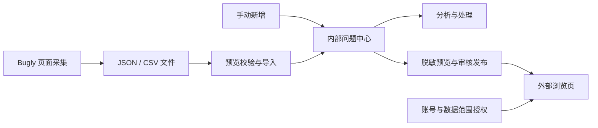

# Bugly 数据管理与外部浏览方案

日期：2026-10-09。状态：方案对应的第一期已完成开发与验证，尚未部署公网。实际操作及升级步骤见 [使用与部署说明](Bugly问题中心-使用与部署说明.md)。

本方案基于指定的 `bugly-exporter-extension-v0.1.0` 插件及当前 APPAuto 测试管理平台代码。暂按“外部合作方使用受限账号，浏览指定数据”设计；公司内部跨部门浏览可沿用相同授权机制，无账号分享作为后续可选功能。

## 1. 建议方案与交付目标

在现有测试管理平台增加独立的“Bugly 问题中心”，提供问题列表、上报记录详情、手动新增、JSON/CSV 导入、处理状态及权限管理；另提供精简的外部浏览入口，让外部人员登录后只看到授权范围内已发布、已脱敏的内容。

第一期沿用插件已有的文件导出能力，流程为“Bugly 采集 → 导出文件 → 平台预览导入 → 内部分析 → 审核发布 → 外部查看”。第二期再给插件增加直接上传，减少手动操作。

第一期完成后的具体效果：

- 测试人员可在平台新增问题，也可将当前插件导出的 JSON/CSV 批量导入。
- 开发和测试可按应用、版本、时间、状态、设备及堆栈关键词查找问题。
- 相同问题下的多次上报集中展示，重复导入不会重复计数。
- 管理员可指定谁能看哪个应用，或仅授权某几个问题，并设置授权到期时间。
- 外部人员无需安装插件、无需 Bugly 账号，可查看已发布的脱敏问题与上报详情。
- 新导入、重新采集及内部编辑的内容先进入内部视图，审核发布后才进入外部视图。

## 2. 已核实的现有条件

### 插件能力

插件是 Chrome/Edge Manifest V3 内容脚本扩展，通过点击当前 Bugly 问题页面的“上报 ID”获取详情及解析堆栈，目前仅下载文件，没有平台上传接口调用。

| 内容 | 已导出字段 | 对平台设计的影响 |
|---|---|---|
| 文件元信息 | `schemaVersion=1`、`exporter`、`pageUrl`、采集起止时间 | 第一期开箱兼容当前 JSON 格式 |
| 问题 | `issue.issueId`、`issue.title` | 建立问题主记录 |
| 上报 | `reports[].reportId`、`collectedAt`、`pageUrl` | 建立问题下的多条上报记录 |
| 列表与现场 | `listFields`、`detailFields` | 提取版本、设备、发生时间、应用包名等常用筛选字段 |
| 堆栈 | `stack.text/mode/frameCount/nativeFrameCount/javaFrameCount` | 保留原文、解析状态及质量提示 |
| 采集辅助 | `rawDetailText`、`visibleTabs`、`captureDiagnostics` | 内部排查与解析兜底 |
| 批次统计 | `totalDiscovered/totalSucceeded/totalFailed`、`failures` | 展示采集完整度及失败原因 |

CSV 包含 `issueId`、`issueTitle`、`reportId`、`collectedAt`、`列表.*`、`详情.*`、`stackMode`、`frameCount`、`stack`、`pageUrl`，列名可能随现场字段变化。它不保留 JSON 的全部原始文本、诊断及批次失败信息，因此推荐 JSON 为主，CSV 为兼容入口。

现有采集限制必须体现在产品里：

1. 只采集当前页可识别的上报记录，不自动翻页，不代表该问题的全部历史数据。
2. `issueId` 可能识别不到；应用的稳定 Bugly App ID 没有独立导出，不能只凭问题编号合并。
3. `visibleTabs` 仅表示识别到标签，不证明已完整采集跟踪日志、跟踪数据等标签内容。
4. 发生时间、应用版本等字段是页面文本，可能缺失或格式变化；发生时间和采集时间需要分开保存。
5. 堆栈可能是 `fallback` 模式，不能据此认定符号表解析已经完成。

### 平台能力

当前代码使用 FastAPI、SQLAlchemy、SQLite 和原生 HTML/CSS/JS，已有 JWT 登录、页面权限及审计服务，并已有独立页面入口示例，可以沿用现有架构开发。

已核实的关键文件：`app/main.py`、`app/api/deps.py`、`app/models/user.py`、`app/models/software.py`、`app/models/bug.py`、`app/services/permission_service.py`、`app/services/audit_service.py`、`app/api/routes/sse.py`。

现有用户角色只有 `admin/user`，页面权限不能直接表达“指定应用、只读、脱敏、授权有效期”。`is_team_member` 是团队成员标记，不能直接当作外部访问限制。目前 SSE 可向登录用户发送全局事件，外部账号须在后端禁止访问该事件流。

## 3. 页面与使用流程

内部入口建议为 `/bugly`，平台导航新增“Bugly 问题中心”；外部入口建议为 `/bugly/external`。两个入口共用数据库与业务服务，后端按访问者身份返回不同字段和可见内容。



### 3.1 问题列表

页面上方为统计与筛选，下方以表格展示问题。提供“问题视图 / 上报视图”切换：默认按问题聚合，排查设备和时间时切换到逐条上报。

```text
Bugly 问题中心                         [新增问题] [导入文件] [导入记录] [权限管理]
已导入问题  已导入上报  待处理问题  采集质量待检查
应用｜版本｜异常类型｜状态｜发生时间｜设备｜关键词             [查询] [重置]

问题编号 / 标题｜应用｜涉及版本｜已导入上报数｜已导入记录最近发生时间｜负责人｜状态
#12345 ...    ｜A   ｜1.2.3   ｜18          ｜2026-10-08 ...            ｜张三  ｜处理中

[上一页]  第 1 页 / 共 N 页  [下一页]                 每页 20 / 50 / 100 条
```

统计明确使用“已导入上报数”“已导入记录最早/最近发生时间”。如果后续采集到 Bugly 原站总次数，单独显示并标注来源和采集时间。不同页面重复导出的批次计数不能相加作为总次数。

筛选变化时更新地址参数，详情支持直接链接及返回列表时恢复筛选。外部页面隐藏内部管理操作，仅显示授权数据对应的筛选项和统计。

### 3.2 问题详情

- 概览：标题、问题编号、应用、涉及版本、内部处理状态、负责人、分析结论及外部发布状态。
- 上报记录：按发生时间排序，可按版本/设备筛选，点击切换记录，支持上一条/下一条。
- 堆栈：等宽字体、保留换行、行号、关键词定位、展开全文；标注解析模式和帧数。
- 现场信息：版本、设备、系统、包名、CPU、ROM、前后台状态等字段分组展示，缺失显示“未采集”。
- 内部扩展区：原始文本、诊断、导入来源与修订记录，按独立权限开放。
- 处理记录：内部分析、状态变化；提供单独的“对外说明”字段，避免内部备注自动对外展示。

异常类型可以人工维护；从堆栈推测的类型标记为“待确认”。处理状态建议为“待分析、处理中、待验证、已关闭、忽略”，与 Bugly 原站状态及外部发布状态分别管理。

### 3.3 手动新增

提供“新增问题”和问题详情中的“新增上报”。新增问题最少填写所属应用和标题；Bugly 问题编号、版本、发生时间、设备、堆栈等选填。

无 Bugly 编号的手工问题使用平台内部 ID；无上报编号的手工记录生成内部 UUID，不伪造 Bugly 编号。以后补充真实编号时，先提示匹配或合并，合并操作保留审计记录。

### 3.4 文件导入

导入流程为“选择应用 → 选择一个或多个文件 → 校验并预览 → 确认写入 → 查看结果”。

- 应用必须选择已建档的 Bugly 数据空间，展示产品、来源站点、Bugly App ID（如已确认）、包名及 Android/iOS 平台，减少选错。
- 默认完整兼容当前 JSON；CSV 按当前插件字段前缀映射。Excel 模板可放第二期。
- 预览显示问题数、上报数、预计新增、重复、待更新、失败及缺失字段；允许确认仅导入有效记录。
- `issueId` 缺失时要求人工确认归属问题或进入待归类区，不按标题自动合并。
- 堆栈缺失、`fallback` 或等待超时作为质量提示，不强制丢弃有价值的现场记录。
- `failures` 保存在导入批次中，作为采集失败项展示，不生成成功上报记录。
- 字段未知时保留在内部扩展字段里，避免页面变化造成信息丢失；未知字段不会自动对外开放。
- JSON 的批次统计与实际数组长度不一致时提示核查；平台写入结果以实际校验记录为准。
- 支持含 BOM、引号和多行堆栈的 CSV，避免将一段堆栈拆成多条数据。

## 4. 权限管理及外部浏览

### 4.1 权限矩阵

下表为新增模块的业务权限，可用独立授权表实现，不需要把现有全平台角色枚举直接扩成这四种角色。

| 能力 | 系统管理员 | 应用维护者 | 内部查看者 | 外部查看者 |
|---|---|---|---|---|
| 查看范围 | 全部 | 授权应用 | 授权应用/问题 | 授权应用/问题内已发布内容 |
| 新增、导入 | 是 | 是 | 否 | 否 |
| 编辑分析、处理状态 | 是 | 是 | 否 | 否 |
| 归档问题 | 是 | 是 | 否 | 否 |
| 查看原始文本和敏感字段 | 是 | 单独授权 | 单独授权 | 否 |
| 审核发布、撤回外部内容 | 是 | 单独授予发布权 | 否 | 否 |
| 导出内部原始数据 | 是 | 单独授权 | 默认否 | 否 |
| 管理外部账号和授权 | 是 | 默认否 | 否 | 否 |

授权以应用为主要范围，支持追加指定问题授权。应用授权覆盖该应用未来新问题，但外部账号仍只看到审核发布后的版本；若仅需分享固定问题，应使用问题级授权。每项授权保存授予人、授予时间和到期时间，可随时撤销。

### 4.2 外部账号与接口隔离

建议复用账号密码登录，新增 `account_type=internal/external`、启用状态及账号有效期，原有用户迁移为内部用户。外部账号登录成功后直接进入外部页面。

后端统一执行：

1. 检查账号是否启用、是否到期及会话是否有效。
2. 外部账号仅允许登录、当前用户信息、修改本人密码、退出及外部 Bugly 查询接口；其他平台接口默认拒绝。
3. 每次查询校验应用/问题授权和发布版本，包括列表、详情、筛选选项、统计以及任何后续下载接口。
4. 禁止外部账号访问全局 SSE、报表、用户列表、需求数据、禅道/Jenkins 绑定及其他内部接口。
5. 停用账号使已有会话失效；撤销授权在下一次请求即生效，敏感响应禁止浏览器与共享代理缓存。

统一入口限制需覆盖已登录接口的鉴权依赖，以及任何独立鉴权、公开导出、静态文件或文件下载通道。不能只在前端导航上做限制，也不能假设所有旧接口均已执行页面权限检查。空授权列表必须表示没有权限，不能回退到默认页面。

权限采用默认拒绝、每次请求校验的规则，参考 [OWASP 授权指南](https://cheatsheetseries.owasp.org/cheatsheets/Authorization_Cheat_Sheet.html)。

### 4.3 对外内容发布与脱敏

内部保存原始采集内容，外部查询接口使用独立字段白名单和已审核的发布快照。

默认可发布：问题标题、经审核的异常类型、版本、必要设备/系统信息、审核后的堆栈、对外说明。负责人姓名及处理状态根据业务需要显式选择是否发布。

默认不发布：用户 ID、账号、Token、设备唯一标识、内部服务器地址、本地文件路径、原始文本、采集诊断、内部备注、原始 Bugly 链接及上传文件。必要路径用占位文本替换，堆栈保留排查所需的函数名与行号。

提供“外部人员视角预览”。自动脱敏辅助识别常见敏感内容，最终由有发布权的人审核；自由文本不能仅靠正则承诺完全脱敏。

发布保存问题和上报的审核版本。后续导入新增上报或改动堆栈时，外部继续看到旧发布快照，页面提示有未发布变更；再次审核后更新快照。撤回后外部不能再获取内容，但无法收回访问者此前保存或复制的信息。

### 4.4 外网访问条件

“页面授权”和“网络可达”分别处理。若平台仅在内网，应由部署环境提供 HTTPS 外部入口，优先只暴露外部页面、登录及外部查询所需路径，入口网关和应用后端同时限制访问范围。内部管理页面继续走现有内部入口。

需要确认域名、服务器、证书、外部接入方式及现有代理路径，不预先假定已经具备公网地址。创建外部账号前需完成接口隔离和越权验收。

无账号分享可在第二期增加：随机分享令牌、指定问题、到期时间、可选访问码、随时撤销，只返回已发布快照。分享链接可能被转发，适合短期分享；需要按个人追溯时仍采用实名分配的独立账号。

## 5. 数据结构及去重规则

### 5.1 建议数据表

| 表 | 主要职责与字段 |
|---|---|
| `bugly_applications` | 来源实例/站点、Bugly App ID（可为空）、产品关联、包名、系统平台、环境、名称；提供稳定的平台内部应用 ID |
| `bugly_issues` | 应用 ID、Bugly issue ID（可为空）、标题、人工类型、内部状态、负责人、分析结论、创建/更新时间、归档标记 |
| `bugly_reports` | 问题 ID、report ID（可为空）、发生/上报/采集时间、时区、版本、设备、系统、堆栈和解析质量、扩展字段、当前内容版本 |
| `bugly_report_revisions` | 上报修订历史、原始结构化内容、内容哈希、来源批次、修订人/时间 |
| `bugly_import_batches` | 上传者、目标应用、文件名/哈希、schemaVersion、采集统计及失败项、实际导入统计、处理状态、确认幂等键 |
| `bugly_import_items` | 批次内逐条新增/跳过/更新/失败结果、报告关联、失败原因与可重试项 |
| `bugly_grants` | 用户、应用或指定问题、业务角色/操作权限、授予人、有效期 |
| `bugly_publications` | 问题及所选上报的脱敏快照、审核者/时间、发布版本、发布/撤回状态 |

优先复用现有软件产品、用户、版本及审计能力。Bugly 版本文本与平台版本分别保存，只有确认匹配后建立关联。原始数据不得保存到 `/static` 等可公开下载目录；如需留存上传源文件，放入受保护存储，仅通过校验权限的接口读取。

### 5.2 去重与更新

- 问题自然键：`应用数据空间 ID + Bugly issueId`。
- 上报自然键：`问题内部 ID + Bugly reportId`；保留不同应用/问题下的编号隔离。
- Bugly 编号一律按字符串保存，避免前导零及数值转换问题。
- 无真实编号的手工数据以内部 UUID 标识，禁止将所有空编号视为同一条。
- 相同编号、内容未变化：跳过，保留本次批次关联。
- 相同编号、内容变化：预览提示；确认后产生修订版本，保留旧值。JSON/CSV 中未提供的字段不擦除已有字段。
- 导入仅更新采集字段，不覆盖人工分析、负责人、处理状态或对外发布内容。
- 数据库设置唯一约束，确认导入使用幂等键，避免重复点击及并发导入产生重复记录。
- 文件哈希用于识别重复文件；不能只按文件名或文件哈希解决记录去重。

示例：第一次导入 A 应用的问题 `12345`，包含报告 `1001/1002`；第二次导入同一问题，包含 `1002/1003`。最终该问题有 3 条上报，`1002` 根据内容变化跳过或修订，批次记录保留两次采集的信息。

发生时间没有时区时按导入所选来源时区解析，并保留原值和时区；不将 `collectedAt` 填充为发生时间。不明确的相对时间保留原文并标记待确认。

## 6. 技术落地与接口建议

沿用当前后端与前端技术栈。业务按照路由 → 服务 → 数据访问分层实现，SQLite 先承担一期规模，通过分页和应用/时间/版本索引控制查询成本；是否迁移数据库由真实数据量和并发写入压测决定。

| 范围 | 建议文件或改动 |
|---|---|
| 内部页面 | `frontend/bugly/index.html`、`app.js`、`style.css` |
| 外部页面 | `frontend/bugly/external.html`、`external.js`，采用受限入口 |
| 页面路由 | `app/main.py` 注册 `/bugly`、`/bugly/external`；内部导航增加入口 |
| API 与结构 | 新增 Bugly 路由、请求/响应结构、模型与服务，注册到 `app/api/router.py` |
| 权限 | `permission_service.py` 增加内部页面键；新增模块数据范围校验及外部账号接口限制 |
| 账号 | 用户模型、登录与鉴权增加账号类别/停用/有效期；管理页提供外部账号创建和授权 |
| 数据库升级 | 为新增表与用户字段提供可重复执行的升级脚本，执行前备份，不只依赖建表操作 |
| 审计 | 记录新增、导入、修改、授权、发布、撤回及外部详情访问；审计中不写敏感全文 |

接口路径为建议，实施时统一按现有路由前缀组织：

| 操作 | 接口示例 | 权限重点 |
|---|---|---|
| 内部列表、详情及上报 | `GET /api/bugly/issues`、`GET /api/bugly/issues/{id}`、`GET /api/bugly/issues/{id}/reports` | 模块权限 + 数据范围 |
| 新增与编辑 | `POST /api/bugly/issues`、`POST /api/bugly/issues/{id}/reports`、`PATCH /api/bugly/issues/{id}` | 应用维护权；字段白名单 |
| 导入预览与确认 | `POST /api/bugly/imports/preview`、`POST /api/bugly/imports/{id}/confirm` | 目标应用维护权；确认时再次校验 |
| 导入记录 | `GET /api/bugly/imports/{id}` | 应用范围；限制批次原文访问 |
| 对外发布与撤回 | `POST /api/bugly/issues/{id}/publication`、`DELETE /api/bugly/issues/{id}/publication` | 发布权 + 问题范围 |
| 外部列表、详情及筛选 | `GET /api/bugly/external/issues`、`GET /api/bugly/external/issues/{id}`、`GET /api/bugly/external/filters` | 有效授权 + 发布快照，独立输出结构 |
| 授权管理 | `POST /api/bugly/grants`、`DELETE /api/bugly/grants/{id}` | 系统管理员 |

问题列表采用轻量摘要响应，堆栈和原始文本按需加载。第一期关键词搜索覆盖标题、问题/报告编号、堆栈；数据增大后根据查询耗时评估全文索引。

导入建议初始限制为单文件 20 MB、单批次 2,000 条，作为可配置值，使用真实样本后调整。预览结果保存为短期有效的服务端导入任务，避免确认时信任客户端修改后的结果；有效期可设为 30 分钟。结构错误拒绝，条目错误逐条列出；一次确认的有效条目统一提交，数据库错误回滚后允许幂等重试。

后端校验文件类型、结构、字段长度、文件大小及记录数量，堆栈与原始文本作为纯文本渲染。CSV 导出如后续开放，处理公式开头的单元格。文件导入控制参考 [OWASP 文件上传指南](https://cheatsheetseries.owasp.org/cheatsheets/File_Upload_Cheat_Sheet.html)。

Bugly 数据可通过可选关联指向平台现有 Bug、需求和版本。新增的数据表独立保存采集证据；只有明确建立业务关联后才参与既有测试统计，避免每条崩溃上报都变成一个缺陷并影响现有报表。

## 7. 分期实施与工作量

### 第一期：可管理、可导入、可受控对外浏览

交付独立内外页面、问题与上报模型、手动新增、现有 JSON/CSV 导入、搜索筛选、详情堆栈、重复导入处理、应用/问题授权、外部账号隔离、脱敏审核发布及审计。

| 工作包 | 粗略工作量 |
|---|---|
| 真实样本确认、字段映射与数据结构 | 1–2 人日 |
| 新增/导入/去重/批次与详情接口 | 3–4 人日 |
| 内部列表、详情、表单与导入页面 | 2–3 人日 |
| 外部账号隔离、权限管理与发布快照 | 3–4 人日 |
| 联调、越权验收、数据库升级及部署验证 | 2–3 人日 |
| 合计 | 11–16 人日 |

估算以熟悉项目的开发人员、现有插件格式及已具备可用部署环境为前提，属于工作量区间，不是承诺上线日期。外网入口申请、证书与组织审批耗时另计；现有接口覆盖情况和真实数据质量可能调整工作量。

### 第二期：降低采集上传成本

为插件增加“上传到测试平台”，配置目标服务、选择应用、显示上传结果并支持重试。上传与文件导入走同一个标准化和去重服务，保留本地导出备用。

需要新增扩展后台上传逻辑、限定平台域名权限及插件端身份授权；优先采用平台登录后配对的短期上传凭证，限定应用和导入操作，不使用 Bugly 密码或共享管理员 Token。直接上传功能另行核实 Chrome 扩展接口及平台跨域配置。

可选增加 Excel 模板、受限分享链接、显式关联现有 Bug，以及真实规模下的后台导入和全文检索。预估 3–6 人日起，不含自动翻页与全天候同步；DOM 自动翻页需单独验证。

## 8. 验收场景

1. 现有 `schemaVersion=1` JSON 成功导入，堆栈换行及中文字段保持正确，CSV 中带引号、多行堆栈也能导入。
2. 多个应用有相同问题/报告编号时不会误合并；同一问题跨文件重复报告只计一次；并发/重复确认不产生重复数据。
3. CSV 缺失诊断或原始文本时不擦除已有 JSON 数据；重新采集不覆盖人工分析和发布快照。
4. 手动创建无 Bugly 编号的问题和上报正常使用，补编号存在冲突时先提示合并。
5. 空堆栈、`fallback`、等待超时、失败项、未知字段及缺失问题编号均有明确结果，页面不会宣称采集全部数据。
6. 内部查看者不能新增/修改；应用维护者不能操作其他应用；无授权账号获取不到列表、详情、统计和筛选项。
7. 外部账号即使手动调用接口或修改问题 ID，也看不到未授权、未发布、原始敏感数据、全局 SSE 和其他平台模块。
8. 外部可见版本经过审核脱敏；重新导入的数据保持内部可见，重新发布才更新外部内容。
9. 停用账号、授权到期、撤销授权和撤回发布在后续请求生效；旧页面重新请求不会从共享缓存拿到受限内容。
10. 外部网络可通过 HTTPS 登录并打开指定问题；内部账号的原有登录、权限和业务功能通过回归检查。
11. 使用代表性的大堆栈和接近导入上限的文件验证速度、内存及回滚重试；审计能追溯上传人、授权人和发布人。

## 9. 实施前需要补齐的信息

以下内容影响配置或排期，不影响本方案主要架构：

- “外人”是外部合作方、内部跨部门人员还是免登录链接访问者；本文暂按外部受限账号。
- 一份实际导出的脱敏 JSON 和 CSV，用于核实字段名、发生时间格式、App ID 是否能从来源页面稳定获取及堆栈规模。目前依据插件代码确认格式，未拿到实际数据样本。
- 需要管理的应用/包名/系统平台/来源站点、应用与现有软件产品的对应关系，以及预计每月数据量。
- 外部人员需要看到哪些字段、谁负责审核发布、是否有个人账号到期要求。
- 测试平台现有部署地址、外网或合作方网络接入方式。
- 是否需要上传后立即关联现有缺陷流程；一期默认先存为独立问题资料，可人工关联。

可用于领导评审的表述：在现有测试平台建设 Bugly 问题中心，兼容现有插件 JSON/CSV 导入并支持人工新增，以问题聚合多条上报，提供检索、堆栈和现场详情。通过应用/问题授权与审核脱敏发布，让外部合作方只读查看指定资料。先交付文件导入和受控浏览，再增加插件直接上传。
